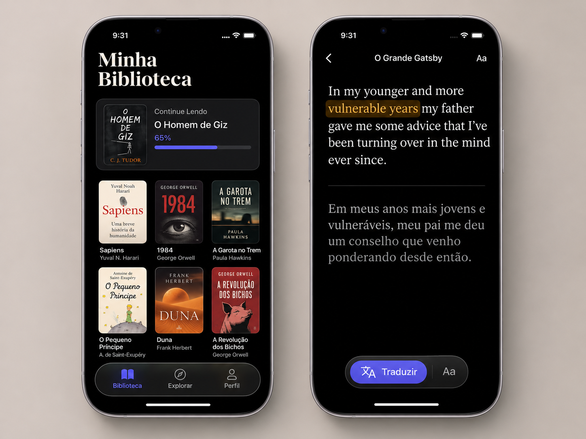
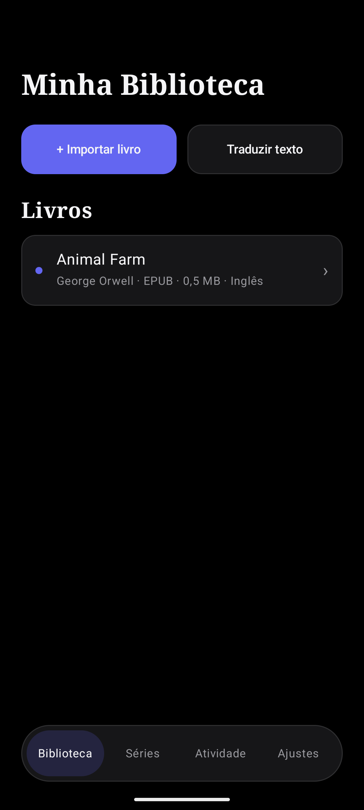
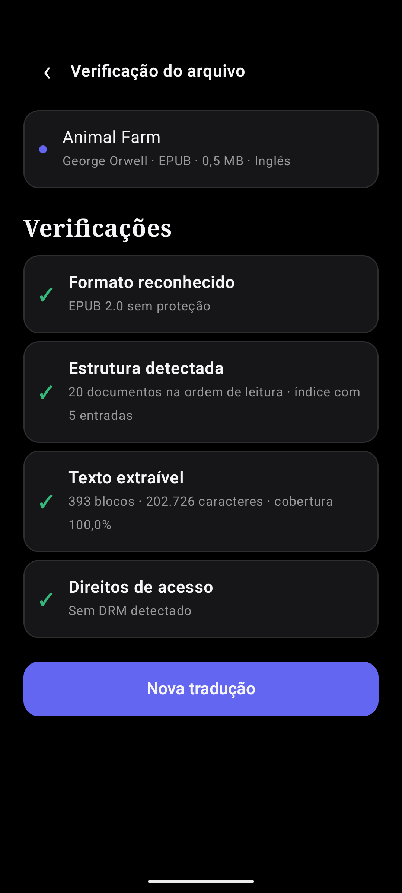
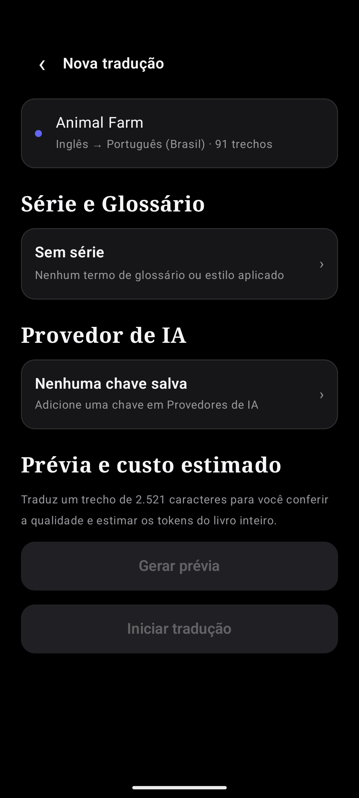
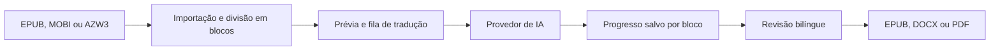

# Bookconverter Android



*Conceito visual da biblioteca e da revisão bilíngue.*

Traduza livros do inglês para o português brasileiro no Android. Importe um ebook sem DRM, faça uma prévia com seu provedor de IA e revise a tradução lado a lado antes de exportar. O app é voltado ao uso pessoal e acompanha o [Bookconverter para desktop](https://github.com/playertwo1/bookconverter).

[Baixar APK](https://github.com/playertwo1/bookconverter-android/releases/latest) · [Primeiro livro](#primeiro-livro) · [Exemplos](#exemplos-de-uso) · [Desenvolvimento](#desenvolvimento)

## Veja o fluxo

| Biblioteca | Verificação do EPUB | Configuração da tradução |
| :---: | :---: | :---: |
|  |  |  |
| Importe seus ebooks. | Confira o conteúdo extraído. | Escolha o provedor e configure a prévia. |

*Capturas do app no emulador Android com um EPUB de exemplo.*

Na etapa seguinte, compare original e tradução antes de exportar. [Veja o mockup da revisão bilíngue](docs/spec/04_DESIGN/screens/16_Revisao_bilingue.png).


## Instalação

1. Em um dispositivo com **Android 14 ou superior** (`arm64-v8a` ou `x86_64`), baixe o APK assinado na [página de releases](https://github.com/playertwo1/bookconverter-android/releases/latest).
2. Abra o APK. Se o Android solicitar, autorize a instalação de apps pela origem usada para abrir o arquivo.
3. No app, abra **Ajustes → Provedores**, configure o acesso a um serviço e selecione o modelo. A tradução usa conexão com a internet para provedores remotos e pode gerar cobranças conforme o serviço escolhido.

## Primeiro livro

1. Na biblioteca, importe um arquivo **EPUB 2/3**, **MOBI** ou **AZW3** sem DRM. Confira os capítulos e a cobertura de texto na tela de verificação.
2. Inicie uma nova tradução, gere a prévia e confira a estimativa de tokens. Se quiser limitar o consumo, defina um teto de tokens antes de iniciar.
3. Acompanhe o progresso pela notificação. Você pode pausar ou retomar a tradução e adicionar outros livros à fila.
4. Na revisão bilíngue, edite ou retraduza os trechos necessários. Exporte a versão em pt-BR como **EPUB, DOCX ou PDF** e compartilhe o arquivo pelo Android. O livro original é preservado.

## Exemplos de uso

**Traduzir um livro para ler em outro aparelho.** Importe um EPUB em inglês, gere a prévia e inicie a tradução. Depois de revisar, exporte em EPUB para abrir em um leitor compatível. Escolha DOCX se quiser continuar editando em um editor de texto.

**Manter nomes consistentes entre volumes.** Crie uma série, vincule os livros e importe um glossário TXT com uma entrada por linha. Os termos entram no contexto quando aparecem no trecho em tradução.

```text
Moon Harbor → Porto da Lua
Council of Tides → Conselho das Marés
```

**Traduzir só um parágrafo.** Na biblioteca, abra **Traduzir texto** e cole, por exemplo, “The lighthouse went dark before dawn.” Uma tradução possível seria “O farol se apagou antes do amanhecer.” Exporte em TXT ou Markdown se quiser guardar o trecho.

## Como funciona



O app guarda uma cópia privada do livro e envia os trechos ao provedor configurado para traduzi-los. A tradução pode ser retomada a partir dos blocos já salvos. A exportação gera um arquivo separado em português.

## Recursos

- **Provedores** — OpenAI, ChatGPT via login, Anthropic, Google Gemini e OpenRouter. O adaptador genérico aceita URL base de serviços compatíveis com `/v1/chat/completions`. OpenAI, Anthropic e Gemini oferecem processamento assíncrono pela Batch API.
- **Fila e retomada** — processa um livro por vez e salva o progresso por bloco. O trabalho pode aguardar quando falta rede, quando o provedor limita requisições ou quando o teto de tokens é atingido.
- **Séries e consistência** — reúna livros de uma série, defina notas de estilo e importe glossários do desktop em TXT (`termo → tradução` ou `termo -> tradução`). O app pode sugerir termos, personagens e pares EN↔PT a partir de volumes anteriores, com trechos de origem e conflitos para revisão. A seleção de pares relevantes ocorre localmente.
- **Informações do livro (fontes públicas)** — ao criar ou editar uma série, você pode buscar dados bibliográficos (ISBN, editora, data, idioma, resumo breve, posição do livro na série, personagens e locais) na **Open Library**, na **Wikidata** e, opcionalmente, na **Hardcover** se configurar seu token pessoal em **Ajustes**. Na revisão você escolhe o que salvar (incluindo envio opcional de personagens e locais ao glossário da série). Nessas buscas são enviados apenas o ISBN, o título e/ou o autor informados, além do endereço IP da conexão e do cabeçalho `User-Agent` do app (sem e-mail, dados pessoais ou texto do livro). Nenhum dado é salvo sem revisão e confirmação. Quando configurado, o token é enviado somente à Hardcover no cabeçalho de autorização. A [documentação da Hardcover](https://github.com/hardcoverapp/hardcover-docs/blob/main/src/content/docs/api/Getting-Started.mdx) recomenda OAuth para apps. O Bookconverter aceita um token opcional para uso pessoal.
- **Texto avulso** — use **Traduzir texto** para colar um trecho, aplicar opcionalmente o contexto de uma série e exportar em TXT, DOCX, PDF ou Markdown.
- **Backup e preferências** — exporte ou restaure um ZIP com banco, livros e glossários. As credenciais são protegidas pelo Android Keystore e ficam fora do backup. A interface oferece temas claro, AMOLED e do sistema, além de suporte a fonte ampliada e TalkBack.

## Desenvolvimento

Use um **JDK 17** para a toolchain Kotlin/JVM e instale pelo Android Studio o **Android SDK 36**, o **NDK (Side by side)** e o **CMake 3.22.1**. Configure o caminho do SDK local pelo Android Studio e execute os comandos na raiz do repositório.

```powershell
.\gradlew.bat :app:assembleDebug
.\gradlew.bat :core:test :app:testDebugUnitTest
.\gradlew.bat :app:connectedDebugAndroidTest
```

No Linux ou macOS, use `./gradlew` no lugar de `.\gradlew.bat`. Os testes instrumentados precisam de um aparelho ou emulador compatível conectado. Para instalar o APK de depuração:

```powershell
adb install -r app/build/outputs/apk/debug/app-debug.apk
```

Os testes de integração com OpenAI, Anthropic e Gemini usam, respectivamente, `OPENAI_API_KEY`, `ANTHROPIC_API_KEY` e `GEMINI_API_KEY`. Cada provedor precisa da sua própria chave. Para executar a etapa de tradução desses testes, defina também a variável correspondente `OPENAI_MODEL`, `ANTHROPIC_MODEL` ou `GEMINI_MODEL`.

- [`app/`](app/) reúne as telas Jetpack Compose, a persistência Room, a execução em segundo plano via WorkManager e a conversão nativa de MOBI/AZW3 via `libmobi`.
- [`core/`](core/) reúne o processamento de EPUB, os adaptadores de provedores, o motor de tradução e a lógica de memória de série em Kotlin/JVM.

## Documentação

- [Especificação do produto e critérios de aceite](docs/spec/README_COMECE_AQUI.md)
- [Índice e precedência dos documentos](docs/README.md)
- [Decisões técnicas](docs/DECISOES.md)
- [Roadmap](ROADMAP.md)
- [Notas da versão 1.0.0](docs/releases/v1.0.0.md)
